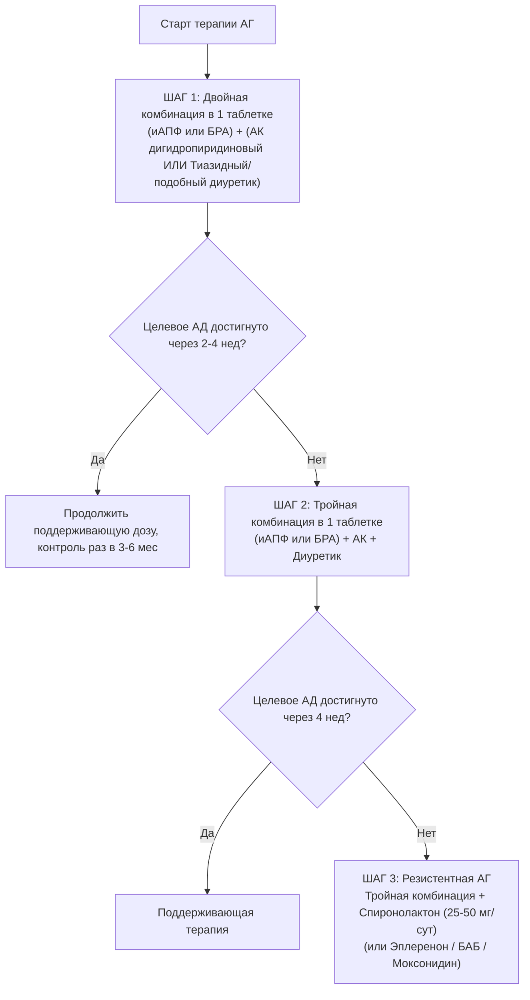

# Артериальная гипертензия у взрослых: Клинический протокол и схемы терапии

> **Основание:** Клинические рекомендации МЗ РФ и РКО «Артериальная гипертензия у взрослых» (2020–2024 гг.).

---

## 1. Классификация уровней артериального давления (мм рт. ст.)

| Категория АД | Систолическое АД (САД) | | Диастолическое АД (ДАД) |
| :--- | :---: | :---: | :---: |
| **Оптимальное** | $< 120$ | и | $< 80$ |
| **Нормальное** | $120\text{–}129$ | и/или | $80\text{–}84$ |
| **Высокое нормальное** | $130\text{–}139$ | и/или | $85\text{–}89$ |
| **АГ 1-й степени** | $140\text{–}159$ | и/или | $90\text{–}99$ |
| **АГ 2-й степени** | $160\text{–}179$ | и/или | $100\text{–}109$ |
| **АГ 3-й степени** | $\ge 180$ | и/или | $\ge 110$ |
| **Изолированная систолическая АГ** | $\ge 140$ | и | $< 90$ |

---

## 2. Целевые уровни АД

1. **Общая популяция пациентов 18–64 года:**
   - Первичная цель: снижение АД $< 140/90$ мм рт. ст.
   - Окончательная цель: достижение уровня **$120\text{–}129 / 70\text{–}79$ мм рт. ст.** при хорошей переносимости.
2. **Пациенты $\ge 65$ лет:**
   - Целевой диапазон САД: **$130\text{–}139$ мм рт. ст.**
   - Целевой диапазон ДАД: **$70\text{–}79$ мм рт. ст.**
3. **Пациенты с хронической болезнью почек (ХБП):**
   - Целевой уровень САД: **$130\text{–}139$ мм рт. ст.** (не снижать ниже 120 мм рт. ст. во избежание снижения почечного кровотока).
4. **Важнейшее правило:** ДАД не должно опускаться ниже **$70$ мм рт. ст.** (риск ухудшения коронарной перфузии миокарда).

---

## 3. Алгоритм выбора медикаментозной терапии

### 3.1. Стратегия одной таблетки (Single-Pill Combination)
Большинству пациентов показана **стартовая комбинированная терапия из 2 компонентов в 1 таблетке**. Монотерапия допустима только при низком риске и АГ 1 степени (САД $< 150$) или у пациентов старше 80 лет / с выраженным синдромом старческой астении.

### 3.2. Особые клинические ситуации для выбора классов
- **ИБС / Перенесенный инфаркт миокарда / ХСН со сниженной ФВ:** Бета-адреноблокатор + иАПФ (или БРА).
- **Хроническая болезнь почек (протеинурия / микроальбуминурия):** иАПФ или БРА обязательно (нефропротекция). Не комбинировать иАПФ + БРА вместе (повышает риск гиперкалиемии и ОПП!).
- **Сахарный диабет / Метаболический синдром:** иАПФ или БРА + АК. Избегать комбинации БАБ + высокие дозы тиазидов (ухудшают углеводный и липидный обмен).
- **Мерцательная аритмия (фибрилляция предсердий):** Бета-адреноблокатор для контроля ЧСС + иАПФ/БРА.
- **Беременность:** Допегит (метилдопа), Нифедипин с замедленным высвобождением, Лабеталол. **иАПФ, БРА и спиронолактон категорически противопоказаны (тератогенность)!**

---

## 4. Справочник антигипертензивных препаратов

### 4.1. Ингибиторы АПФ (иАПФ)
- **Периндоприл:**
  - Начальная: 4–5 мг 1 р/сут утром.
  - Целевая/Максимальная: 8–10 мг 1 р/сут.
  - Плюсы: выраженная органопротекция, 24-часовой профиль действия.
- **Рамиприл:**
  - Начальная: 2.5–5 мг 1 р/сут.
  - Целевая/Максимальная: 10 мг 1 р/сут.
- **Эналаприл:**
  - Начальная: 5 мг 2 р/сут.
  - Целевая: 10–20 мг 2 р/сут (макс. 40 мг/сут).
  - Минус: требует строго двукратного приема из-за короткого T1/2.
- *Побочный эффект группы:* Сухой мучительный кашель (у 5–15% пациентов за счет накопления брадикинина) $\rightarrow$ повод для перехода на БРА.

### 4.2. Блокаторы рецепторов ангиотензина II (БРА, сартаны)
- **Телмисартан:**
  - Начальная: 40 мг 1 р/сут. Максимальная: 80 мг 1 р/сут.
  - Самый длительный период полувыведения ($> 24$ часов), активирует PPAR-$\gamma$ (благоприятен при диабете).
- **Валсартан:**
  - Начальная: 80 мг 1 р/сут. Максимальная: 160–320 мг 1 р/сут.
- **Лозартан:**
  - Начальная: 50 мг 1 р/сут. Максимальная: 100 мг 1 р/сут.
  - Обладает урикозурическим свойством (препарат выбора при сопутствующей гиперурикемии и подагре).
- **Кандесартан:**
  - Начальная: 8 мг 1 р/сут. Максимальная: 16–32 мг 1 р/сут. Доказан при ХСН.

### 4.3. Антагонисты кальция (дигидропиридиновые)
- **Амлодипин:**
  - Начальная: 5 мг 1 р/сут. Максимальная: 10 мг 1 р/сут.
  - Мощный сосудорасширяющий эффект. Побочный эффект: безболезненные симметричные отеки лодыжек (следствие прекапиллярной вазодилатации, не связаны с задержкой жидкости!).
- **Лерканидипин:**
  - Начальная: 10 мг 1 р/сут. Максимальная: 20 мг 1 р/сут.
  - Высокоселективен к сосудистой стенке. Частота периферических отеков в 3–4 раза ниже, чем у амлодипина.

### 4.4. Тиазидные и тиазидоподобные диуретики
- **Индапамид ретард:**
  - Доза: 1.5 мг 1 раз в сутки утром.
  - Метаболически нейтрален, расширяет сосуды, превосходит гидрохлоротиазид по кардиопротекции.
- **Гидрохлоротиазид (ГХТ):**
  - Доза: 12.5–25 мг 1 раз в сутки утром.
  - Требует контроля уровня калия, натрия и мочевой кислоты в крови.

### 4.5. Бета-адреноблокаторы (кардиоселективные)
- **Бисопролол:** 2.5–5–10 мг 1 раз в сутки утром.
- **Метопролола сукцинат (Беталок ЗОК):** 25–50–100 мг 1 раз в сутки.
- **Небиволол:** 5 мг 1 раз в сутки (дополнительный вазодилатирующий эффект за счет оксида азота NO, минимум влияния на эректильную функцию).

---

## 5. Популярные фиксированные комбинации в РФ
1. **иАПФ + АК:**
   - Периндоприл + Амлодипин (*Престанс*, *Дальнева*): 5/5, 5/10, 10/5, 10/10 мг.
2. **иАПФ + Диуретик:**
   - Периндоприл + Индапамид (*Нолипрел А*, *Ко-Дальнева*): 2.5/0.625, 5/1.25, 10/2.5 мг.
   - Эналаприл + Гидрохлоротиазид (*Энап-Н*, *Ко-Ренитек*).
3. **БРА + АК:**
   - Телмисартан + Амлодипин (*Твинста*, *Телмиста АМ*): 40/5, 40/10, 80/5, 80/10 мг.
   - Валсартан + Амлодипин (*Эксфорж*, *Вамлосет*): 80/5, 160/5, 160/10 мг.
4. **Тройные комбинации:**
   - Периндоприл + Индапамид + Амлодипин (*Трипликсам*, *Ко-Вамлосет*): 5/1.25/5, 10/2.5/5, 10/2.5/10 мг.

---

## 6. Неотложные состояния при артериальной гипертензии

### Неосложненный криз
- **Критерий:** выраженный подъем АД (часто $> 180/110$ мм рт. ст.) при сохранном общем состоянии, без симптомов острой дисфункции сердца, мозга или почек.
- **Терапия:**
  1. Успокоить пациента, положение полусидя.
  2. **Каптоприл** 25 мг сублингвально (разжевать и держать под языком). Эффект через 15–20 минут.
  3. ИЛИ **Моксонидин** 0.2–0.4 мг под язык или внутрь.
- **Целевой темп:** снижение САД на 20–25% в течение первых 2 часов. Резкое падение давления до нормы опасно развитием ишемического инсульта у пожилых!

### Осложненный криз (Red Flags 🚨)
- **Признаки:** острейшая загрудинная боль (подозрение на инфаркт или расслоение аорты), удушье и клокочущее дыхание (отек легких), очаговый неврологический дефицит/парез/асимметрия лица (инсульт), энцефалопатия с судорогами.
- **Действия:** Немедленно вызвать реанимационную бригаду СМП! Категорически запрещено снижать давление таблетками под язык быстрыми темпами. Госпитализация в БИТ/ОРИТ.
